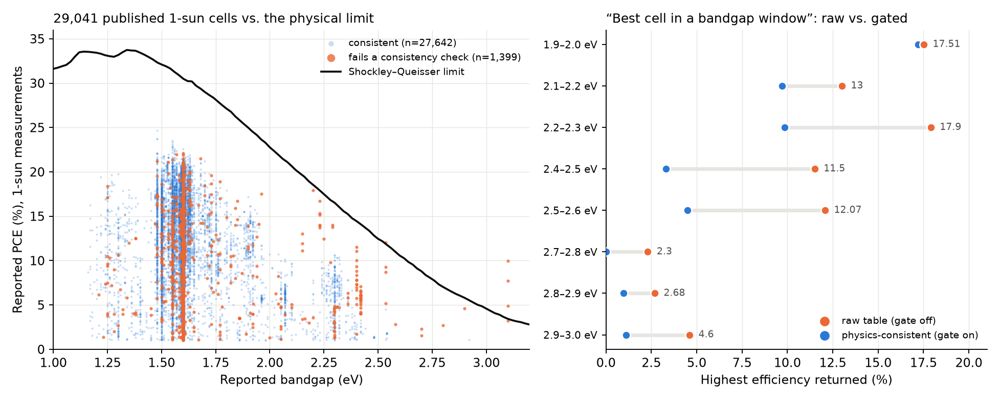
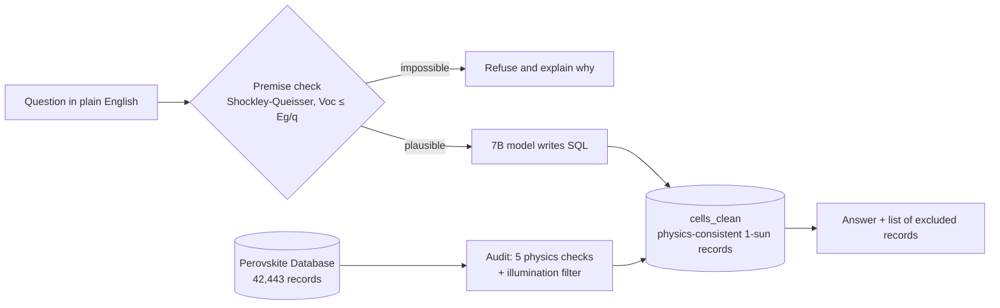
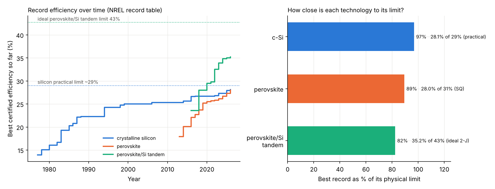

<div align="center">

# OpenLattice

### A physics gate for language-model answers over solar-cell literature data

*Language models trust every record in a scientific database. About 5% of the largest public perovskite database contradicts its own physics. OpenLattice finds those records and keeps them out of the answer.*

   

**Open Scientific Intelligence (OSI) Hackathon · CSIR-NCL Pune · 21–22 Oct 2026**
Team OpenLattice: **Neel Khairnar** · **Mayur Kharche**



</div>

---

## In one minute

| | |
|---|---|
| **Problem** | A model that answers from a scientific database repeats whatever the records say, even when the numbers contradict each other or the laws of physics. |
| **What we did** | We audited every 1-sun record in the [Perovskite Database](https://zenodo.org/records/5837035) against the Shockley–Queisser limit and four related checks, then built a gate that makes a language model answer only from physics-consistent records and refuse impossible claims with an explanation. |
| **What we found** | 1,399 of 29,041 standard-condition records (**4.8%**, across **741 of 5,707 papers**) fail at least one check. In **8 of 16** "best cell in a bandgap window" questions the raw table's answer came only from failing records. With the gate: **0 of 16**. |
| **Silicon vs perovskite** | We added NREL's record-cell table. Best perovskite cell **28.0%** vs best silicon **28.1%**, so efficiency is no longer the gap. Stability is: only 4.3% of perovskite records report a lifetime, median T80 150 h, longest 8,400 h, none reach a year. |
| **Why it matters** | Any AI assistant over materials data inherits these errors. The same pattern works for batteries, semiconductors and other fields with physical constraints. |

## See it work

Same question, same 7B model, same prompt. Only the data differs.

> **"What is the highest power conversion efficiency reported under standard 1-sun illumination for a single-junction perovskite solar cell with a bandgap of at least 2.2 eV and strictly below 2.3 eV?"**

| | Answer | Where it came from |
|---|---|---|
| Gate **off** (raw table) | **17.9 %** | a MAPbBr3 record whose own Jsc is 3.25 mA/cm², which cannot produce that efficiency |
| Gate **on** | **9.86 %** | the best physics-consistent record, with the excluded records listed |

> **"Which paper reported a perovskite solar cell with a 1.9 eV bandgap reaching 28% efficiency?"**
> Gate on: *"Not physically possible: PCE 28.0% exceeds the Shockley–Queisser limit of 25.0% at Eg = 1.9 eV."* Gate off: *"No paper was found."*

## How it works



**The five checks** (applied only to standard 1-sun measurements, 90–110 mW/cm²):

1. Voc cannot exceed the bandgap (Voc ≤ Eg/q)
2. Jsc cannot exceed the photon-limited current for that bandgap (2% tolerance)
3. PCE cannot exceed the Shockley–Queisser limit (+0.5 pt tolerance)
4. Fill factor cannot exceed 0.90
5. PCE must agree with Voc × Jsc × FF (10% tolerance)

Measurements under other light (for example indoor fluorescent light at 0.27 mW/cm²) are kept apart rather than judged against a 1-sun limit. We learned this when our first check flagged a real 36% indoor-light record as impossible.

## Results

Qwen2.5-7B-Instruct on one RTX 3090, **identical prompt and schema in both arms**, 55 questions.

| Test | Gate off (raw table) | Gate on |
|---|---|---|
| Best efficiency in a bandgap window (16) | 8 / 16 answers come only from failing records | **0 / 16** |
| Counts of high-efficiency cells (14) | differ from the physics-consistent count on 9 / 14 (mean error 79 records, max 535) | **exact on 14 / 14** |
| Impossible premises (25) | not flagged ("none found") | **25 / 25 flagged with the reason** |

Where the failures come from: most are PCE that disagrees with Voc × Jsc × FF (1,280). Photon-limit violations (117) often reveal a mislabelled bandgap, for example MAPbI3 listed at 2.15 eV. Only 3 records exceed the Shockley–Queisser limit.

## Silicon vs perovskite: why is perovskite not on the market yet?

We added NREL's [Best Research-Cell Efficiency table](https://www.nrel.gov/pv/cell-efficiency.html) (563 record entries, 1976–2026) and a second gate for silicon and tandem claims.



| Technology | Best record (2026) | Physical limit used | Record as share of limit |
|---|---|---|---|
| Crystalline silicon | 28.1 % | 33.5 % (Shockley–Queisser, 1.12 eV); practical about 29 % | 84 % (97 % of practical) |
| Perovskite, single junction | 28.0 % | 31.3 % (assumes 1.5–1.6 eV; the table has no bandgap) | 89 % |
| Perovskite/silicon tandem | 35.2 % | 42.7 % (ideal two-terminal, 1.68/1.12 eV) | 82 % |

- **Efficiency is not the blocker.** Single-junction records differ by 0.1 points.
- **Stability is.** In the physics-consistent perovskite records, 1,763 of 40,706 report a T80 lifetime (median 150 h, longest 8,400 h, none one year). Commercial silicon modules typically carry 25-year or longer warranties (general industry knowledge, not from our data). The database holds typical devices, not record cells.
- **Claim gate for silicon.** "Silicon at 40 %" and "tandem at 48 %" are refused as impossible. "Silicon at 31 %" is flagged as above the practical limit of about 29 % (Kowalczewski and Andreani, arXiv:1505.03985).
- **Answer check.** Any figure the model writes that is not in the verified facts is flagged. This caught a model slip ("1.3 points lower" instead of 0.1) during testing.
- The NREL table itself contains Voc values entered in mV (3 rows, fixed by the cleaning step) and 2 rows whose efficiency disagrees with Voc × Jsc × FF.

Lead-iodide spotlight (`spotlight.py`): 27,992 of 42,443 records (about two thirds) are pure lead-iodide compositions. The best consistent MAPbI3 cell reaches 22.2 % (73 % of its limit), FAPbI3 24.7 % (76 %). The bandgap ranges used for those compositions are provisional.

## Honest limitations

- **"Fails a check" means inconsistent as recorded, not proven wrong.** Some mismatches mix an average with a champion value. We checked a small sample against source papers, not all of them.
- **The ground truth is defined by our own filter**, so accuracy figures describe how often the raw table's answer is affected, not an independent score.
- **The impossible-premise result comes from a deterministic rule**, not from model intelligence. The baseline did not make anything up; it just never explained why nothing exists.
- One perovskite database, one 7B model, 55 questions. Perovskite and tandem limits assume typical bandgaps, so they are estimates.
- Electrochemical cells (batteries) are a planned extension of the same method (for example capacity cannot exceed nF/3.6M, coulombic efficiency cannot exceed 100%); not built yet.
- Related work exists (see below). To our knowledge, the new parts are applying a detailed-balance (Shockley–Queisser) consistency audit to the Perovskite Database with quantified results, and an answer-time gate that restricts SQL answers to consistent 1-sun records and refuses impossible premises. We have not exhaustively searched for prior work.

## Related work (found with Valency semantic search)

| Work | Relation to OpenLattice |
|---|---|
| [PERLA: an autonomous living database for perovskite photovoltaics](https://arxiv.org/abs/2601.17807) | LLM-based extraction and validation for the perovskite database; we audit and gate answers over the existing curated records |
| [Benchmark for Structured RAG in Perovskite Photovoltaics](https://arxiv.org/abs/2610.25575) | question answering over the same data; we add a physics layer on top of structured retrieval |
| [Perovskite-LLM](https://arxiv.org/abs/2502.12669) | domain-tuned language model for perovskite research |
| [Grounded verification of chemical and materials reasoning](https://arxiv.org/abs/2607.17417) | closest in spirit: deterministic claim checks against databases and physical law for formulas and structures; ours targets photovoltaic device records and the Shockley–Queisser limit |
| [Physics as the label (MatPCR)](https://arxiv.org/abs/2609.12181) | physical-consistency benchmark for materials reasoning |
| [When Literature Data Mislead AI in Materials Discovery](https://arxiv.org/abs/2609.01621) | shows literature-derived values are often not internally consistent (solid electrolytes); our audit quantifies this for perovskite devices |

## Quickstart

```bash
git clone https://github.com/Neel-K26/OpenLattice && cd OpenLattice
pip install -r requirements.txt

# 1. download the database CSV from https://zenodo.org/records/5837035 and place it at data/perovskite_db.csv
python build_db.py data/perovskite_db.csv      # builds lattice.duckdb with the physics flags
python audit2.py data/perovskite_db.csv        # audit summary and figure

# silicon vs perovskite (needs NREL's cell-efficiency xlsx)
python pv_compare.py cell-efficiency-data-table.xlsx

# 2. evaluation (needs a GPU with ~24 GB for the 7B model)
python make_questions.py && python run_eval.py && python analyze.py
```

**Demo:** open `OpenLattice.ipynb` in Jupyter and run the cells (pick an example, choose *Compare both*), or run the marimo app: `marimo run app.py`.

## Repository map

| File | Role |
|---|---|
| `physics_checks.py` | Shockley–Queisser limit, photon-limited current, claim checks |
| `build_db.py` | builds `lattice.duckdb`, flags every record, defines the clean view |
| `agent.py` | text-to-SQL with the physics gate and structured answers |
| `make_questions.py` · `run_eval.py` · `analyze.py` | evaluation set, runner and scoring |
| `audit2.py` | database audit and figure |
| `pv_limits.py` · `pv_compare.py` | silicon and tandem limits; NREL comparison and figure |
| `compare_agent.py` · `compare_cell.py` | cross-technology answers with claim gate and number check; notebook cell |
| `spotlight.py` | lead-iodide statistics |
| `app.py` · `OpenLattice.ipynb` | marimo app and Jupyter demo |
| `results.csv` · `summary.csv` · `questions.json` | raw evaluation outputs and questions |

## What was reused

The project scaffold (text-to-SQL agent structure, evaluation runner, DuckDB setup) was adapted from our earlier oil-and-gas domain-model work. Everything specific to solar cells was built during the hackathon: the physics checks, audit, gate, question set, evaluation, silicon comparison, notebook and this repository.

## Team

**Neel Khairnar** (lead: code and strategy) · **Mayur Kharche**

## License

MIT. The Perovskite Database is distributed under its own terms; see its Zenodo record.
